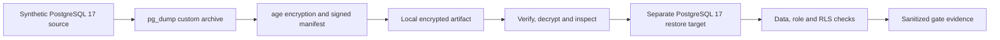

# Cloud Disaster Recovery Lab

**PostgreSQL 17 · Encrypted backup design · Isolated recovery · Tenant isolation · PowerShell 7**

> **Portfolio status (November 2026): Phase 1 local runtime validation passed; Phase 2 implementation is a code-review candidate, with runtime recovery gates unverified.** This repository is a synthetic engineering demonstration, not a production recovery system.

## Why this project exists

A backup file alone does not establish recoverability. A useful disaster recovery design must verify the archive, protect its contents, restore into a known isolated destination, check data integrity, and retest authorization boundaries. This project documents and implements those checks using entirely fictional organizations, assets, and recovery events.

## Architecture



**The complete Phase 2 path above is implemented as a review candidate, not yet demonstrated end-to-end.** See [architecture](docs/ARCHITECTURE.md), [Phase 2 implementation review](docs/PHASE2-FINAL-IMPLEMENTATION-REVIEW.md), and [source diagram](diagrams/architecture.mmd).

## What is verified?

| Area | Evidence status |
| --- | --- |
| Phase 1 Docker Compose and synthetic PostgreSQL 17 lab | **Passed local runtime checks (12/12 reported)** |
| Phase 1 synthetic dataset and RLS checks | **Included in the 12 local runtime checks** |
| Phase 1 preservation in Phase 2 package | **29/29 files matched by SHA-256** |
| Phase 2 archive structure | **53 files, archive hash checked locally** |
| Phase 2 Compose static configuration | **Passed with locally installed PostgreSQL image digest** |
| Phase 2 encrypted backup, signed manifest, isolated restore, G1–G8 gates | **Implemented, runtime validation pending** |
| Phase 2 Pester failure-injection tests | **Included, not executed** |
| Observed RPO/RTO for Phase 2 | **Not measured** |
| Production readiness | **Not claimed** |

The validation observations above were performed locally during development; no independently signed evidence bundle or public CI run is provided here. A local Docker image digest check is **not** independent registry provenance verification.

## Repository guide

- [`infrastructure/docker/`](infrastructure/docker/) — synthetic source/recovery Compose and separately named Phase 2 restore environment
- [`sample-data/`](sample-data/) — fictional PostgreSQL schema, RLS policies, seed data
- [`scripts/powershell/`](scripts/powershell/) — reviewed backup, restore, verification, preflight and evidence code
- [`tests/`](tests/) — foundation checks and Phase 2 Pester tests
- [`docs/`](docs/) — threat model, recovery runbook, security, RPO/RTO methodology, failure matrix, review findings
- [`diagrams/architecture.mmd`](diagrams/architecture.mmd) — editable architecture source

## Reproduce the foundation safely

**Prerequisites:** Docker Engine and Docker Compose. These commands create local containers and volumes and must be run only on an isolated development machine. Never use real customer data or production credentials.

```powershell
docker compose -f infrastructure/docker/compose.yaml config --quiet
docker compose -f infrastructure/docker/compose.yaml up -d --wait
docker compose -f infrastructure/docker/compose.yaml exec -T source psql -U lab_owner -d labdb -c 'SELECT count(*) FROM lab.assets;'
docker compose -f infrastructure/docker/compose.yaml down
```

`down` does not delete the named database volumes. **Do not run `down -v` unless you deliberately intend to destroy disposable lab data.** The foundation uses a public demonstration password and has no published database ports. The Phase 1 image is pinned to the `17-bookworm` tag, not an immutable digest.

**Do not execute the Phase 2 migration or recovery scripts as a quick-start.** They are not yet runtime approved. Review [Phase 2 Windows instructions](scripts/powershell/README-PHASE2.md) and [unresolved risks](docs/PHASE2-FINAL-IMPLEMENTATION-REVIEW.md) first. The Phase 2 restore service has a separate Compose project and volume; do not merge deployment commands merely because a combined syntax check succeeds.

## Security boundaries

This repository contains only fictional data and sample credentials. No CLOUMA application database, production backup, real connection string, private key, or cloud environment is required. Local container networking is not equivalent to TLS. PostgreSQL owner/superuser checks do not prove tenant isolation: use restricted roles to validate RLS. A signed manifest does not by itself provide durable anti-rollback protection.

## Next milestones

1. Run isolated Phase 2 PowerShell/Pester syntax and unit checks.
2. Independently verify the PostgreSQL image digest and platform.
3. Validate approved source migration against a disposable synthetic recovery copy.
4. Execute G1–G8 and failure-injection cases against an isolated restore target.
5. Publish sanitized, reproducible evidence with observed recovery timings and limitations.

## License and use

See [LICENSE](LICENSE), [SECURITY](docs/SECURITY.md), and [limitations](docs/LIMITATIONS.md). This is an educational portfolio artifact, not an operational backup product.
